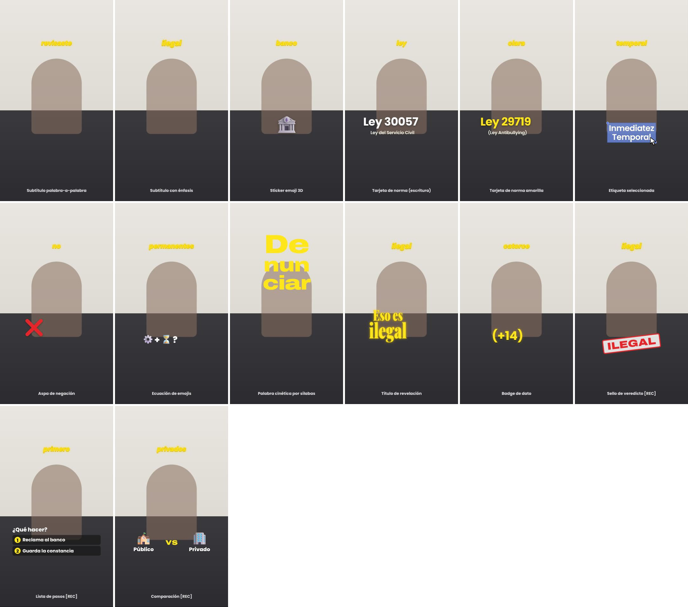

# Guía de componentes y del EDL



Regenerar el catálogo: `node scripts/library-sheet.mjs` · verlo animado: `npm run studio` → `ComponentLibrary`.

## EDL (`projects/<slug>/edl.json`)
Esquema completo en `src/lib/schema.ts`. Tiempos de `segments` = segundos del **footage**;
tiempos de `captions`, `overlays`, `sfx` = segundos de la **edición final**.

```jsonc
{
  "segments": [
    {"id": "s01", "in": 4.97, "out": 6.78, "role": "hook", "framing": "crash", "move": "crash"},
    {"id": "s02", "in": 6.78, "out": 8.59, "role": "context", "framing": "subtleIn"}
  ],
  "captions": [{"text": "denunciaste", "start": 0.08, "end": 0.48, "emphasis": false}],
  "overlays": [
    {"type": "lawCard", "title": "Ley 29719", "subtitle": "(Ley Antibullying)", "color": "yellow", "start": 22.05, "end": 24.5}
  ],
  "sfx": [{"name": "type", "at": 22.05, "volumeDb": -16}]
}
```
`framing`: `base` · `subtleIn` (1.08×) · `punchIn` (1.16×) · `crash` (1.42×) · `{scale,x,y}`.
`move`: `none` · `settle` · `slowPush` · `crash`.
`role`: hook · reveal · context · legal-basis · translation · build-up · twist · steps · recap · cta.

## Recursos (overlays) — posición `x`,`y` opcional (0–1)
| type | Props | Origen | Cuándo usarlo |
|---|---|---|---|
| `sticker` | `emoji`, `size` | REF | Actor o emoción de la situación (👮 🏦 😱 🤨) |
| `lawCard` | `title`, `subtitle`, `footnote`, `color` | REF | Primera mención de una norma o artículo |
| `selectionLabel` | `text`, `cursor` | REF | Término técnico que el público debe recordar |
| `revealTitle` | `lines` | REF | El veredicto («Eso es / ilegal»), 1 por video |
| `kineticWord` | `syllables`, `layout` (`stack`/`rows`) | REF | Verbo-acción clave (De·nun·ciar), 1 por video. Con `behindPerson: true` y `layout: "rows"` va detrás del presentador |
| `textBadge` | `text` | REF | Edades, plazos, montos: «(+14)», «30 días», «S/ 500» |
| `denyMark` | — | REF | Negación («no», «no puede») |
| `emojiEquation` | `items` | REF | Requisitos como fórmula (⚙️ + ⏳ ?) |
| `documentCover` | `image`, `label` | REF | Mostrar el código/ley físico |
| `logoBadge` | `image`, `label` | REF | Institución citada (Indecopi, SBS, SUNAFIL) |
| `photoCard` | `image`, `rotate`, `w`, `h`, `label`, `credit` | REF | Ejemplo visual concreto (foto con marco blanco, zoom lento, etiqueta amarilla) |
| `cutout` | `image` (PNG), `w`, `rotate`, `label` | REC | Foto SIN FONDO estilo sticker (preferida por el equipo) — `scripts/cutout.py <foto> <salida.png>` |
| `lawPage` | `source`, `heading`, `body` (`**resaltado**`), `highlightAt` | REC | La norma impresa con resaltador sincronizado: prueba visual |
| `backgroundPlate` | `image` | REF* | Contexto en la pared (*sin recorte de persona: franja superior) |
| `bigLetter` | `text` | REF | Variante de una sola letra/palabra gigante |
| `verdictStamp` | `text`, `tone` | MARCA | **Sello de impacto «ESO ES ILEGAL»** (en una pieza, cae de golpe y sacude) con `riser` + `stamp` + `fahhh` |
| `stepList` | `title`, `steps` | REC | «¿Qué hacer?» con 2–3 pasos |
| `comparison` | `left`, `right` | REC | Público vs privado, permitido vs prohibido |

## Emojis (estilo iOS)
Todos los gráficos de emoji usan el diseño de **Apple / iOS** (decisión de Vocare Iuris), incluida la
negación (❌). Fuente: `emoji-image` (160 px) y, si no existe ahí, `emoji-datasource-apple` (64 px
reescalado). Son diseño de Apple: se instalan con `npm install` y no se suben al repositorio.

## Texto detrás de la persona
Cualquier recurso con `"behindPerson": true` se dibuja entre el fondo y el presentador.
`canvas`/`render` generan automáticamente `public/footage/<slug>/person.webm` (recorte con alfa,
MediaPipe selfie_multiclass, ~5 min por 30 s de video en CPU) y lo registran en `edl.personMatte`.

## SFX — paleta Vocare Iuris (`public/sfx/`)
| Sonido | Uso en la edición |
|---|---|
| `pop` | aparición de stickers |
| `click` | etiquetas seleccionadas / cursor |
| `poi` | negaciones (❌), rebotes cómicos |
| `kiran` | revelación positiva, palabra clave (p. ej. «VOLUNTARIO») |
| `riser` | sube la tensión ~1.5 s y desemboca en el veredicto |
| `stamp` | golpe del sello «ESO ES ILEGAL» |
| `fahhh` | reacción tras el veredicto o un dato indignante |
| `whoosh`, `swish`, `type`, `ding`, `boom` | secundarios, usar con moderación |

Los archivos son **aproximaciones sintetizadas**. Para usar los originales de Vocare Iuris:
`npm run sfx:import -- ruta/al/fahhh.mp3 fahhh` (convierte, normaliza y protege de `npm run sfx`).

## Tipografías
| Uso | Fuente | Familia CSS |
|---|---|---|
| Subtítulos | DM Sans Bold (itálica, `CAPTION.italic`) | `FONTS.caption` |
| Tarjetas, etiquetas, badges, pasos, comparación | Poppins 600/700/800 | `FONTS.card` |
| Palabra cinética, letra gigante, sello, «VS» | Druk Wide (sustituto: Archivo Expanded) | `FONTS.wide` |
| Título de revelación | Playfair Display 900 comprimida [APROX, no confirmada] | `FONTS.reveal` |

## Tokens de marca (`src/brand/tokens.ts`)
Cada valor está etiquetado como [REF] (medido), [APROX] (equivalente más cercano) o [REC]
(recomendación). Cambiar un token cambia todos los videos futuros.
